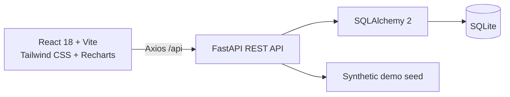
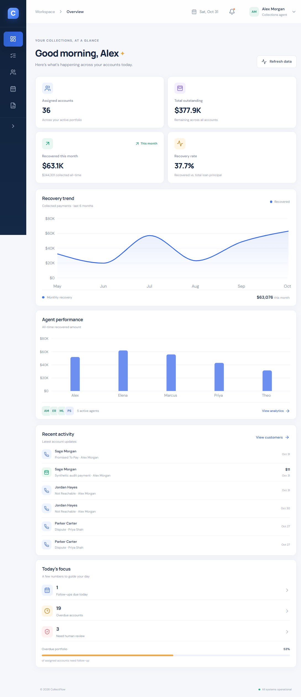
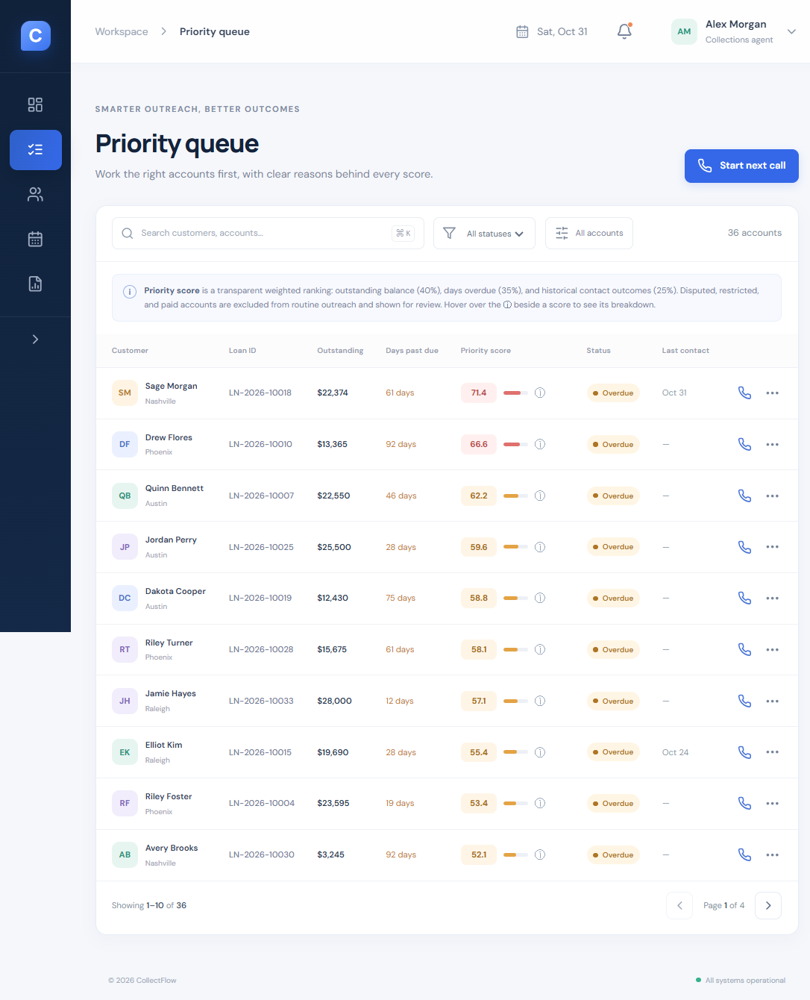
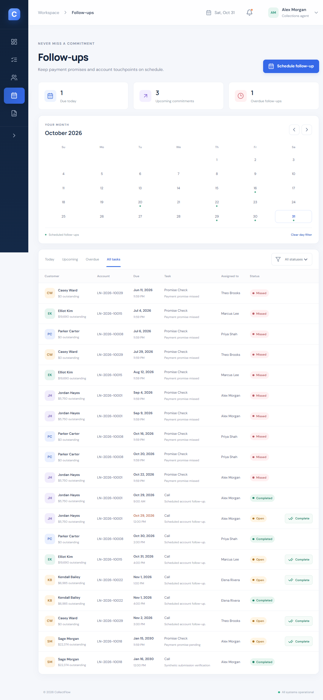
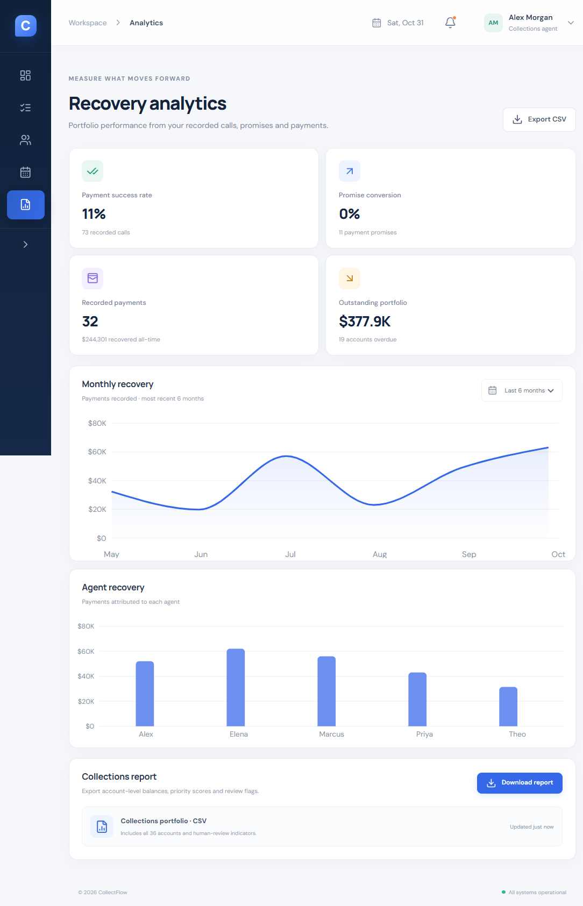

# CollectFlow — Collections Agent Workbench

CollectFlow is a full-stack fintech operations demo for loan-collection agents. It helps agents review assigned loans, prioritize eligible accounts, log collection outcomes, manage payment commitments, and monitor recovery metrics. The application uses **synthetic data only**.

> **Demo / compliance notice:** CollectFlow has no authentication, authorization, payment processor, borrower messaging, or production compliance controls. The seeded people and contact details are synthetic. Do not enter real borrower information or use this application to contact customers. A real deployment requires security, privacy, access-control, retention, audit, and regulatory review.

## Features

- **Dashboard:** database-derived portfolio, outstanding balance, month/all-time recovery, recovery rate, follow-ups, recent account activity, monthly recovery chart, and agent performance.
- **Priority queue:** searchable, status/review filters, priority ordering, score explanations, and paginated results. Disputed, restricted-contact, and paid accounts are never eligible for routine outreach.
- **Customer profiles:** loan balances, payment and call history, promises, follow-ups, and contact restrictions.
- **Call logging:** `PAID`, `PROMISED_TO_PAY`, `NOT_REACHABLE`, and `DISPUTE` outcomes with required notes, optional follow-ups, payment recording, and a human-review confirmation for restricted/disputed accounts.
- **Payments and commitments:** partial/full payments, balance updates, durable promise records, missed-promise detection, and linked follow-up status changes.
- **Follow-ups:** date calendar, today/upcoming/overdue/all filters, task status filters, scheduling, and completion.
- **Analytics and CSV:** recovery trend, agent recovery, payment success, promise conversion, portfolio metrics, and CSV export.
- **Audit trail:** account, call, payment, promise, and follow-up changes, with repeatable import backfills for legacy SQLite data.

## Architecture



### Project structure

```text
backend/
  database.py       SQLite engine, sessions, and legacy follow-up migration
  main.py           FastAPI endpoints, business rules, serialization, and analytics
  models.py         SQLAlchemy entities, relationships, and database constraints
  schemas.py        Pydantic request validation
  seed.py           Synthetic data creation and explicit reset command
  tests/            API workflow, route, metric, and migration tests
  requirements.txt  Backend runtime dependencies
  requirements-dev.txt
frontend/
  src/App.jsx       Workbench pages and user workflows
  src/api.js        Axios API client and report download
  src/styles.css    Responsive styling
  package.json      Frontend dependencies and scripts
  package-lock.json Reproducible npm dependency lock
.env.example        Example values for local configuration
.gitignore          Local secrets, databases, caches, and build output
```

### Database design

The SQLite schema is managed through SQLAlchemy:

- `Customer` has many `Loan` accounts. A customer-level contact restriction applies to all of that customer's loans.
- Each `Loan` belongs to one `Customer` and one `Agent`, and has many `CallLog`, `Payment`, `PaymentPromise`, and `FollowUp` records.
- A `PaymentPromise` is associated with its originating call, loan, and agent; an optional payment records fulfillment. A linked follow-up tracks the promise due date.
- `AuditLog` records changes and may reference a loan, customer, and agent.
- Foreign keys are enabled for SQLite connections. Database checks protect positive principal/payment amounts, nonnegative balances/days past due, and valid call, promise, and follow-up statuses.

Existing SQLite files are upgraded on application startup. The follow-up migration preserves the existing task rows while adding support for missed promises. Promise and audit backfills are idempotent.

### Priority scoring

Each account receives a score from 0 to 100:

```text
score = 40 × (outstanding balance / highest eligible balance)
      + 35 × (days past due / highest eligible days past due)
      + 25 × average historical contact outcome score
```

The contact-history component assigns `NOT_REACHABLE = 1.0`, `PROMISED_TO_PAY = 0.65`, `DISPUTE = 0.0`, and `PAID = 0.0`; accounts without call history use `0.5`. Balance and delinquency are normalized against the currently outreach-eligible portfolio. Scores are rounded to one decimal place and recalculated from database records for account listings and exports. Disputed, restricted, and paid accounts are flagged and excluded from routine prioritization; the call API separately blocks outreach unless human review is explicitly documented.

### Payment and promise behavior

Payments are validated against the current outstanding balance, written with the balance update in the same database transaction, and retained as transaction records. Payments cannot be zero, negative, over the balance, or dated in the future. A payment during an outstanding promise window marks that commitment kept and completes its linked open follow-up. Pending promises past their due time are changed to missed when promise, follow-up, dashboard, or analytics data is read.

## Requirements

- Python 3.10+
- Node.js 18+ and npm

## Install and run

Run the API and frontend in separate terminals from the project root.

### 1. Backend

```powershell
cd backend
python -m venv .venv
.\.venv\Scripts\Activate.ps1
python -m pip install -r requirements.txt
Copy-Item .env.example .env
python seed.py
python -m uvicorn main:app --reload
```

The API listens at `http://127.0.0.1:8000`; OpenAPI documentation is at `http://127.0.0.1:8000/docs`. Tables are initialized and the seed is added on startup if the database has no agents.

To **discard and recreate all tables and data** in the configured database with synthetic demo data, run this from `backend/`:

```powershell
python seed.py --reset
```

`--reset` is destructive: it drops the schema in the database selected by `DATABASE_URL`. Use it only with a disposable demo database. The default database path, `sqlite:///./collectflow.db`, is relative to the backend working directory. Running `python seed.py` without `--reset` preserves an existing database and does not add duplicate sample data.

### 2. Frontend

```powershell
cd frontend
npm ci --registry=https://registry.yarnpkg.com
Copy-Item .env.example .env
npm run dev
```

Open `http://localhost:5173`. Vite proxies `/api` requests to `http://127.0.0.1:8000`, so the default setup does not require direct browser CORS access. To connect directly to another API origin, set `VITE_API_URL` in `frontend/.env` (for example `http://localhost:8000/api`) and add the frontend origin to `FRONTEND_ORIGINS` in `backend/.env`.

Build and preview:

```powershell
cd frontend
npm run build
npm run preview
```

## Configuration

Example files are provided at the project root and in their respective application folders. Copy the application-specific example before editing:

| Variable | Application | Default | Description |
|---|---|---|---|
| `DATABASE_URL` | Backend | `sqlite:///./collectflow.db` | SQLAlchemy database URL |
| `FRONTEND_ORIGINS` | Backend | `http://localhost:5173` | Comma-separated browser origins permitted by CORS |
| `DEMO_AGENT_EMAIL` | Backend | `alex.morgan@collectflow.demo` | Email assigned to the synthetic demo agent |
| `VITE_API_URL` | Frontend | `/api` | API base URL; defaults to the Vite proxy |

Never commit `.env` files or real data. The example files contain demo-only values.

## Demo agent

The seed creates **Alex Morgan** (`alex.morgan@collectflow.demo`) and four additional synthetic agents. These are display identities only; there is no login flow or password. Do not treat the demo email as a credential.

Seeded dataset: 36 synthetic customers and loans, 72 calls, 31 initial payments, five agents, payment promises, follow-up tasks, and audit history. All names, emails, addresses, balances, and activity are generated for this demo.

## REST API

All endpoints are prefixed with `/api`. Interactive request/response schemas and the **Try it out** interface are available from `/docs` while the backend is running.

| Method | Path | Purpose / supported filters |
|---|---|---|
| `GET` | `/health` | Service health |
| `GET` | `/agents` | Active agents |
| `GET` | `/dashboard` | Portfolio metrics, recovery trend, agent performance, recent activities |
| `GET` | `/accounts` | Priority-sorted accounts; `search`, `status`, and `review` query parameters |
| `PATCH` | `/accounts/{loan_id}` | Update days past due, dispute flag, or customer contact restriction |
| `GET` | `/customers` | Customer list; `search` query parameter |
| `GET` | `/customers/{customer_id}` | Customer loans and account activity timeline |
| `GET`, `POST` | `/calls` | List calls (`loan_id`, `limit`) or record a call outcome |
| `GET`, `POST` | `/payments` | List payments (`loan_id`, `limit`) or record a payment |
| `GET`, `POST` | `/followups` | Filter (`period`, `status`) or create a follow-up |
| `PATCH` | `/followups/{followup_id}` | Change follow-up status |
| `GET` | `/promises` | List commitments; `status`, `loan_id`, and `limit` filters |
| `GET` | `/audit-logs` | Audit trail; optional `loan_id` and `limit` filters |
| `GET` | `/analytics` | Database-backed recovery, payment, agent, and promise metrics |
| `GET` | `/reports/collections.csv` | Download account-level CSV report |

### Example requests

```powershell
# List eligible priority-sorted accounts
Invoke-RestMethod http://127.0.0.1:8000/api/accounts

# Record a partial payment
Invoke-RestMethod -Method Post `
  -Uri http://127.0.0.1:8000/api/payments `
  -ContentType "application/json" `
  -Body '{"loan_id":1,"agent_id":1,"amount":"25.00","method":"ACH"}'

# Record a promise to pay
Invoke-RestMethod -Method Post `
  -Uri http://127.0.0.1:8000/api/calls `
  -ContentType "application/json" `
  -Body '{"loan_id":1,"agent_id":1,"outcome":"PROMISED_TO_PAY","notes":"Synthetic demo promise","promise_date":"2030-01-15"}'
```

Responses use standard HTTP statuses: invalid input returns `422`, missing entities return `404`, blocked outreach and integrity conflicts return `409`, and unexpected database failures return `500` with a generic client-facing message. Database errors are logged server-side.

## Tests and verification

From the project root:

```powershell
python -m pip install -r backend\requirements-dev.txt
python -m pytest backend\tests -q
Set-Location frontend
npm ci --registry=https://registry.yarnpkg.com
npm run build
```

The backend tests exercise the REST route inventory, CORS preflight, database-derived metrics, priority recalculation, payment validation and balance changes, call logging, promise resolution/missed follow-ups, audit records, SQLite foreign-key integrity, and legacy follow-up migration.

## Screenshots

Captured from the running synthetic-data demo:

<details>
<summary>Dashboard</summary>



</details>

<details>
<summary>Priority queue</summary>



</details>

<details>
<summary>Follow-up calendar</summary>



</details>

<details>
<summary>Recovery analytics</summary>



</details>
